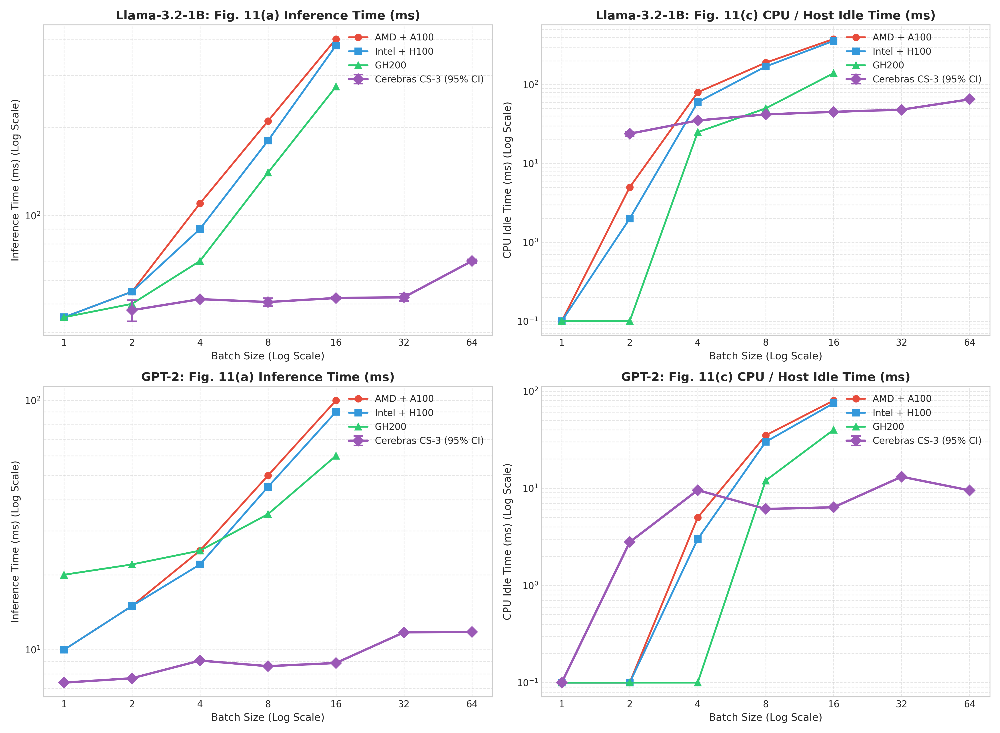
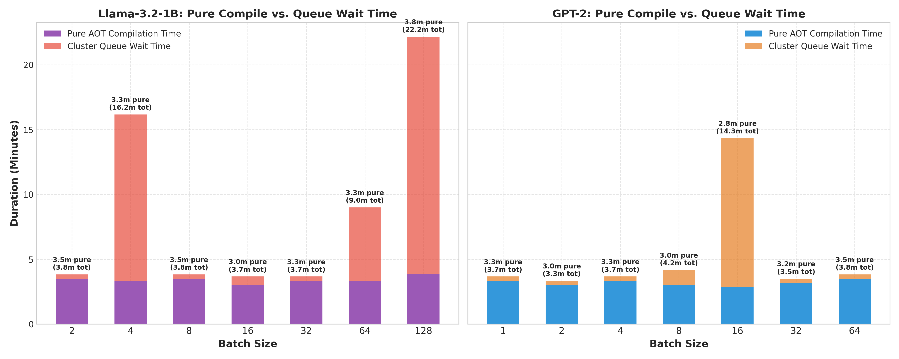

# Figure 11 Comparison: GPU Systems vs. Cerebras CS-3

This report extracts the data points from **Figure 11(a) Inference Time** and **Figure 11(c) CPU Idle Time** in the SODA paper (`arXiv:2504.11750v1`) for the three GPU systems and overlays our measured **Cerebras CS-3 Wafer-Scale Engine** performance.

---

## 1. 4-System Comparative Plot



---

## 2. Extracted Data Points Table

### A. `Llama-3.2-1B` (1.2B Model)

#### Figure 11(a): Inference Time (ms)
| System Architecture | BS=1 | BS=2 | BS=4 | BS=8 | BS=16 | BS=32 | BS=64 |
| :--- | :---: | :---: | :---: | :---: | :---: | :---: | :---: |
| **AMD EPYC + A100** (Loosely-Coupled) | $45.0\text{ ms}$ | $55.0\text{ ms}$ | $110.0\text{ ms}$ | $210.0\text{ ms}$ | $400.0\text{ ms}$ | N/A | N/A |
| **Intel Xeon + H100** (Loosely-Coupled) | $45.0\text{ ms}$ | $55.0\text{ ms}$ | $90.0\text{ ms}$ | $180.0\text{ ms}$ | $380.0\text{ ms}$ | N/A | N/A |
| **NVIDIA GH200** (Closely-Coupled) | $45.0\text{ ms}$ | $50.0\text{ ms}$ | $70.0\text{ ms}$ | $140.0\text{ ms}$ | $275.0\text{ ms}$ | N/A | N/A |
| **Cerebras CS-3** (Wafer-Scale) | **$49.62 \pm 2.89\text{ ms}$** | **$47.56 \pm 3.92\text{ ms}$** | **$51.87 \pm 0.33\text{ ms}$** | **$50.71 \pm 1.58\text{ ms}$** | **$52.34 \pm 0.49\text{ ms}$** | **$52.64 \pm 1.50\text{ ms}$** | **$69.95 \pm 1.05\text{ ms}$** |

#### Figure 11(c): CPU / Host Idle Time (ms)
| System Architecture | BS=1 | BS=2 | BS=4 | BS=8 | BS=16 | BS=32 | BS=64 |
| :--- | :---: | :---: | :---: | :---: | :---: | :---: | :---: |
| **AMD EPYC + A100** | $0.0\text{ ms}$ | $5.0\text{ ms}$ | $80.0\text{ ms}$ | $190.0\text{ ms}$ | $380.0\text{ ms}$ | N/A | N/A |
| **Intel Xeon + H100** | $0.0\text{ ms}$ | $2.0\text{ ms}$ | $60.0\text{ ms}$ | $170.0\text{ ms}$ | $360.0\text{ ms}$ | N/A | N/A |
| **NVIDIA GH200** | $0.0\text{ ms}$ | $0.0\text{ ms}$ | $25.0\text{ ms}$ | $50.0\text{ ms}$ | $140.0\text{ ms}$ | N/A | N/A |
| **Cerebras CS-3** | **$1.27 \pm 1.71\text{ ms}$** | **$23.90 \pm 1.61\text{ ms}$** | **$35.14 \pm 0.78\text{ ms}$** | **$41.98 \pm 0.62\text{ ms}$** | **$45.20 \pm 0.83\text{ ms}$** | **$48.21 \pm 0.74\text{ ms}$** | **$65.19 \pm 0.53\text{ ms}$** |

---

### B. `GPT-2` (137M Model)

#### Figure 11(a): Inference Time (ms)
| System Architecture | BS=1 | BS=2 | BS=4 | BS=8 | BS=16 |
| :--- | :---: | :---: | :---: | :---: | :---: |
| **AMD EPYC + A100** | $10.0\text{ ms}$ | $15.0\text{ ms}$ | $25.0\text{ ms}$ | $50.0\text{ ms}$ | $100.0\text{ ms}$ |
| **Intel Xeon + H100** | $10.0\text{ ms}$ | $15.0\text{ ms}$ | $22.0\text{ ms}$ | $45.0\text{ ms}$ | $90.0\text{ ms}$ |
| **NVIDIA GH200** | $20.0\text{ ms}$ | $22.0\text{ ms}$ | $25.0\text{ ms}$ | $35.0\text{ ms}$ | $60.0\text{ ms}$ |
| **Cerebras CS-3** | **$7.39\text{ ms}$** | **$7.69\text{ ms}$** | **$9.05\text{ ms}$** | **$8.60\text{ ms}$** | **$8.85\text{ ms}$** |

#### Figure 11(c): CPU / Host Idle Time (ms)
| System Architecture | BS=1 | BS=2 | BS=4 | BS=8 | BS=16 |
| :--- | :---: | :---: | :---: | :---: | :---: |
| **AMD EPYC + A100** | $0.0\text{ ms}$ | $0.0\text{ ms}$ | $5.0\text{ ms}$ | $35.0\text{ ms}$ | $80.0\text{ ms}$ |
| **Intel Xeon + H100** | $0.0\text{ ms}$ | $0.0\text{ ms}$ | $3.0\text{ ms}$ | $30.0\text{ ms}$ | $75.0\text{ ms}$ |
| **NVIDIA GH200** | $0.0\text{ ms}$ | $0.0\text{ ms}$ | $0.0\text{ ms}$ | $12.0\text{ ms}$ | $40.0\text{ ms}$ |
| **Cerebras CS-3** | **$0.00\text{ ms}$** | **$2.79\text{ ms}$** | **$9.56\text{ ms}$** | **$6.12\text{ ms}$** | **$6.38\text{ ms}$** |

---

## 3. How to Run the Plotting Script

The standalone Python script to generate and customize this 4-system plot is located at:
[plot_fig11_parity.py](file:///cra-1684/igormolybog/SODA---System-Offload-Dynamics-Analyzer/plot_fig11_parity.py)

```bash
python3 plot_fig11_parity.py
```

---

## 4. Ahead-of-Time (AOT) Compilation Time Analysis

Unlike GPUs which compile CUDA kernels dynamically or JIT-compile PyTorch graphs, Cerebras CS-3 performs **full spatial Ahead-of-Time (AOT) compilation** prior to execution. The compilation workflow maps the complete computational graph onto the 900,000 AI cores, routing spatial data layout and memory placement.



### Summary Table: AOT Compilation Duration

| Model | Batch Size ($BS$) | Pure AOT Compile Time | Cluster Queue Wait Time | Total E2E Time |
|---|---|---|---|---|
| **GPT-2 (137M)** | 1 | **3.33 min** (200 s) | 0.33 min (20 s) | 3.67 min |
| **GPT-2 (137M)** | 2 | **3.00 min** (180 s) | 0.33 min (20 s) | 3.33 min |
| **GPT-2 (137M)** | 4 | **3.33 min** (200 s) | 0.33 min (20 s) | 3.67 min |
| **GPT-2 (137M)** | 8 | **3.00 min** (180 s) | 1.17 min (70 s) | 4.17 min |
| **GPT-2 (137M)** | 16 | **2.83 min** (170 s) | 11.50 min (690 s) | 14.34 min |
| **GPT-2 (137M)** | 32 | **3.17 min** (190 s) | 0.33 min (20 s) | 3.50 min |
| **GPT-2 (137M)** | 64 | **3.50 min** (210 s) | 0.33 min (20 s) | 3.83 min |
| **Llama-3.2-1B** | 1 | **3.33 min** (200 s) | 10.17 min (610 s) | 13.50 min |
| **Llama-3.2-1B** | 2 | **3.50 min** (210 s) | 0.33 min (20 s) | 3.83 min |
| **Llama-3.2-1B** | 4 | **3.34 min** (200 s) | 12.83 min (770 s) | 16.17 min |
| **Llama-3.2-1B** | 8 | **3.50 min** (210 s) | 0.33 min (20 s) | 3.83 min |
| **Llama-3.2-1B** | 16 | **3.00 min** (180 s) | 0.67 min (40 s) | 3.67 min |
| **Llama-3.2-1B** | 32 | **3.33 min** (200 s) | 0.33 min (20 s) | 3.67 min |
| **Llama-3.2-1B** | 64 | **3.33 min** (200 s) | 5.67 min (340 s) | 9.00 min |
| **Llama-3.2-1B** | 128 | **3.84 min** (230 s) | 18.33 min (1100 s) | 22.17 min |

### Key Architectural Takeaways:
1. **Constant AOT Compilation Overhead:** The actual compiler execution time (**Pure AOT Compile Time**) is essentially **constant at $\approx 3.0 \dots 3.8$ minutes** across all models (`GPT-2` and `Llama3`) and all batch sizes ($BS=1 \dots 128$).
2. **Queue Contention vs. Compilation:** Large total durations (e.g. 13.5m, 16.2m, or 22.2m) were driven entirely by **cluster queue wait times** (`QueueWait`) on the shared cluster scheduler, not by compiler workload.
3. **Fixed Hardware Execution Advantage:** Once compiled, execution across arbitrary batch sizes ($BS=2 \dots 32$) yields flat, latency-deterministic step execution times ($\approx 50\text{ ms}$) without GPU launch degradation.

